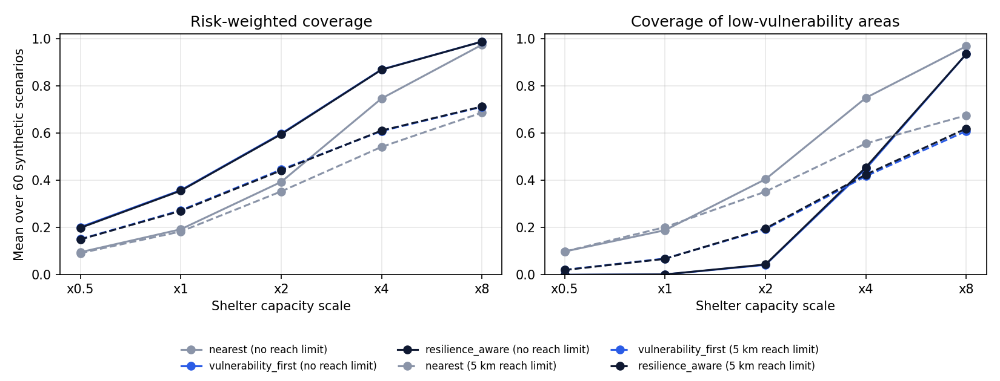

# HeatBridge-PK

**A synthetic benchmark for allocating cooling-centre places during heatwaves with power and water outages, framed on Pakistani cities.**

When a heatwave comes with load-shedding and water shortages, a city's cooling centres can host fewer people than their nominal capacity. HeatBridge-PK asks how three simple allocation rules share those reduced places between neighbourhoods with different heat exposure, social vulnerability and access barriers, and what each rule costs.

> **Synthetic only.** Every neighbourhood and shelter is generated by this package in an abstract 20 km x 20 km plane. No row is a real Pakistani location, and no number here is a measured coverage, health outcome or claim about any city.

## Research question

When usable shelter capacity is cut by power and water reliability, how do nearest-first, vulnerability-first and reliability-aware allocation differ in who is served, and does the reliability term change anything while places are scarce?

## Design

- **Scenarios:** 60 synthetic scenarios (seed 17), each with 35 neighbourhoods and 9 shelters. Each scenario draws one grid shock and one water shock, so shelter reliability falls together.
- **Usable capacity:** `capacity x power_reliability x water_reliability x capacity_scale`.
- **Policies:**
  1. `nearest`: neighbourhoods in a fixed order, each sent to the closest open shelter (small accessibility penalty).
  2. `vulnerability_first`: neighbourhoods with the highest heat exposure x social vulnerability are served first.
  3. `resilience_aware`: as above with a mobility weight, and shelters ranked by power (0.5), water (0.3) and women's safe-access (0.2) reliability plus access barriers.
- **Stress sweep:** capacity scale x0.5, x1, x2, x4, x8 and reach limit none or 5 km (a neighbourhood can only use shelters within 5 km).
- **Comparison:** every policy runs on the same scenarios, so differences against `nearest` are paired by scenario, with 95% percentile bootstrap intervals (2,000 resamples of scenarios).
- **Metrics:** population coverage, risk-weighted coverage (demand weighted by exposure x vulnerability), coverage of high- (>= 0.70) and low- (< 0.40) vulnerability neighbourhoods, mean straight-line distance, and mean service resilience of the places used.

## Run it (Python 3.9+)

```bash
python3 -m venv .venv && source .venv/bin/activate
pip install -r requirements.txt
python -m pytest -q
python -m heatbridge_pk.cli analyze --output-dir outputs
```

`analyze` takes a few seconds and writes `outputs/results.json`, `outputs/results.md`, `outputs/sweep_metrics.csv` and `outputs/figures/coverage_by_capacity.png`. The older single-setting command still works:

```bash
python -m heatbridge_pk.cli experiment --output-dir outputs/default --capacity-scale 1 --max-distance-km 5
python -m heatbridge_pk.cli generate --output-dir data
```

## Results (synthetic, seed 17, 60 scenarios)

Full table: [`outputs/results.md`](outputs/results.md). Paired differences and intervals: [`outputs/results.json`](outputs/results.json).

| Setting | Usable places / demand | Policy | Risk-weighted coverage | Low-vulnerability coverage | Service resilience |
|---|---|---|---|---|---|
| x1, no reach limit | 0.20 | nearest | 0.193 | 0.189 | 0.590 |
| | | vulnerability_first | 0.358 | 0.002 | 0.590 |
| | | resilience_aware | 0.356 | 0.002 | 0.590 |
| x8, no reach limit | 1.58 | nearest | 0.974 | 0.968 | 0.581 |
| | | resilience_aware | 0.987 | 0.935 | 0.588 |
| x8, 5 km reach | 1.58 | nearest | 0.687 | 0.675 | 0.576 |
| | | resilience_aware | 0.712 | 0.619 | 0.583 |

- At the default setting the usable places cover about 20% of demand. All three policies fill every place, so population coverage is identical (0.198); the rule only decides who gets in.
- Vulnerability-first raises risk-weighted coverage by 0.166 (95% CI 0.150 to 0.180) over nearest-first, and low-vulnerability coverage falls by 0.187 (95% CI 0.152 to 0.226), close to zero.
- The reliability term had no effect on service resilience while places were scarce (difference 0.000 at x1). Only with a surplus (x8) did it lift resilience, by 0.007 (95% CI 0.005 to 0.009).
- With a 5 km reach limit, even at x8 capacity only about 69% of demand is served: distance, not capacity, becomes the limit.



## Limitations

- The distributions are illustrative, not calibrated to census, health, utility or geospatial data.
- Straight-line distance ignores roads, transport, heat on the walk and travel time.
- Demand is not a forecast of who would go to a cooling centre, and health outcomes are not simulated.
- Reliability, vulnerability thresholds and resilience weights are design choices that would need checking with people in Pakistan who run heat response.
- Women's safe access is a single number and cannot represent privacy, staffing, opening hours or local context.
- The policies are greedy rules, not optimal allocations, and nothing here shows a causal effect.

## Repository

```text
heatbridge_pk/core.py       scenario generator, allocation and metrics
heatbridge_pk/analysis.py   stress sweep, paired bootstrap, table and figure
heatbridge_pk/cli.py        generate / experiment / analyze commands
tests/                      unit and end-to-end tests (no network)
docs/                       methodology and data dictionary
outputs/                    results.json, results.md, figure
REFERENCES.md               Pakistan context sources
```

## Article

A short write-up of these results is on the Masmatix Insights page: [masmatixinnovations.co.uk/insights/heatbridge-cooling-centre-allocation.html](https://masmatixinnovations.co.uk/insights/heatbridge-cooling-centre-allocation.html).

## Citation and licence

Citation metadata is in [`CITATION.cff`](CITATION.cff). No DOI is assigned yet. Code under the MIT licence ([`LICENSE`](LICENSE)).
